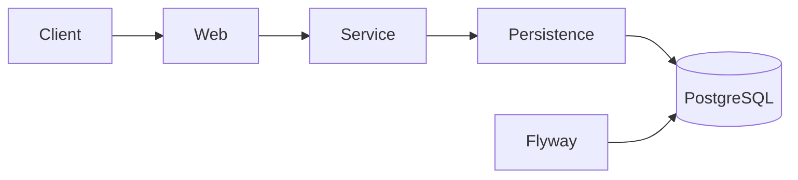

# Food Delivery REST API — Spring MVC Multi-Module

[](https://github.com/Nikkilodeonee/spring-mvc-food-delivery/actions/workflows/build.yml)

A multi-module Spring Boot food ordering API. Customers browse a menu, place orders from a cart, and manage order history — secured with Spring Security and backed by PostgreSQL in production-like environments.

## What problem it solves

Demonstrates how to structure a real backend service: API contracts, persistence, business rules, security, database migrations, containerized deployment, and integration testing against PostgreSQL.

## Architecture

```
api  →  OpenAPI spec and generated DTOs
persistence  →  JPA entities and repositories
service  →  transactional business logic
web  →  REST controllers, security, exception handling
```



### Architecture decisions

- **Multi-module Maven layout** keeps API contracts, domain, business logic, and web layer separated.
- **PostgreSQL + Flyway** for runtime schema control instead of Hibernate `ddl-auto` in production-like profiles.
- **H2 in-memory database** for fast MockMvc tests only (`test` profile).
- **`open-in-view: false`** with `@EntityGraph` on order queries to avoid lazy-loading issues in the web layer.
- **Testcontainers** integration tests validate authentication, ownership, balance rules, and persistence against real PostgreSQL (runs in CI; skipped locally if Docker is unavailable).

## Tech Stack

| Technology | Version |
|------------|---------|
| Java | 17 |
| Spring Boot | 3.4.13 |
| Spring Security | (managed by Spring Boot) |
| Spring Data JPA | (managed by Spring Boot) |
| PostgreSQL | 16 |
| Flyway | (managed by Spring Boot) |
| Testcontainers | 1.20.4 |
| OpenAPI Generator | (api module) |
| Maven Wrapper | 3.9.9 |

## API Endpoints

All `/api/**` endpoints require authentication. Use HTTP Basic Auth or form login.

| Method | Path | Description | Success |
|--------|------|-------------|---------|
| `GET` | `/api/foods` | List all menu items | `200 OK` |
| `GET` | `/api/orders` | List orders for the authenticated customer | `200 OK` |
| `GET` | `/api/orders/{orderId}` | Get a specific order | `200 OK` |
| `POST` | `/api/orders` | Create an order from a cart payload | `201 Created` |
| `GET` | `/actuator/health` | Health check | `200 OK` |
| `GET` | `/actuator/info` | Application info | `200 OK` |

### Error responses

| Status | Condition |
|--------|-----------|
| `400 Bad Request` | Empty cart or insufficient account balance |
| `401 Unauthorized` | Missing or invalid credentials |
| `403 Forbidden` | Order does not belong to the authenticated customer |
| `404 Not Found` | Order not found |

## Getting Started

### Prerequisites

- JDK 17+
- Docker (for Compose and Testcontainers integration tests)

### Run with Docker Compose (recommended)

```bash
docker compose up --build
```

API available at `http://localhost:8080`. PostgreSQL exposed on port `5432`.

### Run locally against PostgreSQL

Start PostgreSQL and set environment variables:

| Variable | Default |
|----------|---------|
| `DB_HOST` | `localhost` |
| `DB_PORT` | `5432` |
| `DB_NAME` | `food_delivery` |
| `DB_USERNAME` | `food_delivery` |
| `DB_PASSWORD` | `food_delivery` |

```bash
./mvnw spring-boot:run -pl web
```

The `local` profile is active by default. Flyway applies migrations on startup.

### Build and test

```bash
./mvnw verify
```

- **MockMvc tests** use the `test` profile with in-memory H2.
- **Testcontainers tests** require Docker and start PostgreSQL automatically.

### Demo accounts

| Username | Password | Balance |
|----------|----------|---------|
| `Smith` | `SmithSecret` | $100 |
| `Jane` | `JaneSecret` | $100 |
| `John` | `JohnSecret` | $10 |

### Example requests

```bash
curl -u Smith:SmithSecret http://localhost:8080/api/foods
curl -u Smith:SmithSecret http://localhost:8080/api/orders
curl -u Smith:SmithSecret -X POST http://localhost:8080/api/orders \
  -H "Content-Type: application/json" \
  -d @web/src/test/resources/ValidCartExample.json
```

## Project Structure

```
spring-mvc-food-delivery/
├── api/
├── persistence/
├── service/
├── web/
│   └── src/main/resources/
│       ├── application.yml
│       ├── application-local.yml
│       ├── application-test.yml
│       └── db/migration/
│           ├── V1__create_schema.sql
│           └── V2__seed_demo_data.sql
├── Dockerfile
├── compose.yaml
└── .github/workflows/build.yml
```

## Business rules

- Orders are created from a cart; the total is deducted from the customer's balance
- Orders cannot be placed with an empty cart
- Orders are rejected when the customer balance is insufficient
- Customers can only view their own orders

## What I learned

- Structuring a Spring Boot backend as Maven modules with clear boundaries
- Managing schema evolution with Flyway instead of ad-hoc SQL scripts
- Testing secured REST APIs with MockMvc and PostgreSQL via Testcontainers
- Running a full stack locally with Docker Compose

## Known limitations / next steps

- Pagination and filtering for foods and orders
- JWT authentication (current flow uses form login / HTTP Basic)
- Admin role for menu management

## License

This project is licensed under the MIT License — see [LICENSE](LICENSE).

## Author

**[Nikkilodeonee](https://github.com/Nikkilodeonee)**
