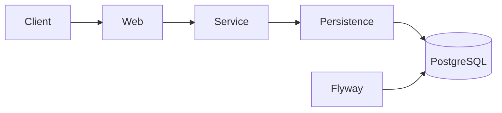

# Food Delivery REST API — Spring MVC Multi-Module

[](https://github.com/Nikkilodeonee/spring-mvc-food-delivery/actions/workflows/build.yml)

Started as an **EPAM Java training** multi-module Spring MVC exercise (food browsing, order placement, and security).  
I later **extended it independently** with PostgreSQL, Flyway migrations, Docker Compose, GitHub Actions CI, and MockMvc + Testcontainers integration tests.

## Highlights

- Multi-module Spring Boot REST API (`api` · `persistence` · `service` · `web`)
- Spring Security **form login** (session cookie) for API access
- PostgreSQL + **Flyway** migrations
- **Docker Compose** local environment
- **GitHub Actions** CI
- **MockMvc** and **Testcontainers** tests
- Transactional order/balance logic with optimistic locking

## Project purpose

Training foundation + personal extensions: layered modules, secured REST endpoints, transactional order logic from a cart payload, and production-like local ops (Postgres, Flyway, Docker, CI).

## Architecture

```text
api          → OpenAPI spec and generated DTOs
persistence  → JPA entities and repositories
service      → transactional business logic
web          → REST controllers, security, exception handling
```



## Architecture decisions

* Multi-module Maven layout separates API contracts, persistence, business logic, and web concerns.
* PostgreSQL + Flyway manage schema evolution in production-like environments.
* H2 is used only for fast MockMvc tests through the `test` profile.
* `open-in-view: false` is enabled to avoid lazy-loading from the web layer.
* `@EntityGraph` is used for order queries that need related order items.
* Testcontainers validates secured API behavior against real PostgreSQL in CI.
* Auth is Spring Security **form login** (not JWT / HTTP Basic). JWT is listed under next steps.

## Tech stack

| Technology      | Version                |
| --------------- | ---------------------- |
| Java            | 17                     |
| Spring Boot     | 3.4.13                 |
| Spring Security | Managed by Spring Boot |
| Spring Data JPA | Managed by Spring Boot |
| PostgreSQL      | 16                     |
| Flyway          | Managed by Spring Boot |
| Testcontainers  | 1.20.4                 |
| Maven Wrapper   | 3.9.9                  |

## API endpoints

All `/api/**` endpoints require an authenticated session (form login).

| Method | Path                    | Description                                | Success       |
| ------ | ----------------------- | ------------------------------------------ | ------------- |
| `GET`  | `/api/foods`            | List all menu items                        | `200 OK`      |
| `GET`  | `/api/orders`           | List orders for the authenticated customer | `200 OK`      |
| `GET`  | `/api/orders/{orderId}` | Get a specific order                       | `200 OK`      |
| `POST` | `/api/orders`           | Create an order from a cart payload        | `201 Created` |
| `GET`  | `/actuator/health`      | Health check                               | `200 OK`      |
| `GET`  | `/actuator/info`        | Application info                           | `200 OK`      |

There is no separate cart CRUD API — the cart is sent as the JSON body of `POST /api/orders`.

## Error responses

API errors return a JSON body:

```json
{
  "error": "BAD_REQUEST",
  "message": "Cart is empty."
}
```

| Status             | `error` value   | Condition                                           |
| ------------------ | --------------- | --------------------------------------------------- |
| `400 Bad Request`  | `BAD_REQUEST`   | Empty cart, insufficient balance, or validation failure |
| `401 Unauthorized` | `UNAUTHORIZED`  | Missing or invalid session                          |
| `403 Forbidden`    | `FORBIDDEN`     | Order does not belong to the authenticated customer |
| `404 Not Found`    | `NOT_FOUND`     | Order not found                                     |
| `409 Conflict`     | `CONFLICT`      | Concurrent balance update (optimistic locking)        |

## Getting started

### Prerequisites

* JDK 17+
* Docker

### Run with Docker Compose

```bash
docker compose up --build
```

API available at:

```text
http://localhost:8080
```

PostgreSQL is exposed on port `5432`.

### Run locally against PostgreSQL

Start PostgreSQL and set environment variables if needed:

| Variable      | Default         |
| ------------- | --------------- |
| `DB_HOST`     | `localhost`     |
| `DB_PORT`     | `5432`          |
| `DB_NAME`     | `food_delivery` |
| `DB_USERNAME` | `food_delivery` |
| `DB_PASSWORD` | `food_delivery` |

```bash
./mvnw spring-boot:run -pl web
```

The `local` profile is active by default. Flyway applies migrations on startup.

## Build and test

```bash
./mvnw verify
```

* MockMvc tests use the `test` profile with in-memory H2.
* Testcontainers tests require Docker and start PostgreSQL automatically.
* GitHub Actions runs the build and test workflow on every push.

## Demo accounts

> **Note:** Demo passwords below are for local development and testing only.  
> In the database they are stored as BCrypt hashes; use the plain-text values with form login.

| Username | Password      | Balance |
| -------- | ------------- | ------- |
| `Smith`  | `SmithSecret` | `$100`  |
| `Jane`   | `JaneSecret`  | `$100`  |
| `John`   | `JohnSecret`  | `$10`   |

## Example requests

Login (saves session cookie), then call the API:

```bash
curl -c cookies.txt -X POST http://localhost:8080/login \
  -d "username=Smith&password=SmithSecret" -L

curl -b cookies.txt http://localhost:8080/api/foods

curl -b cookies.txt http://localhost:8080/api/orders

curl -b cookies.txt -X POST http://localhost:8080/api/orders \
  -H "Content-Type: application/json" \
  -d @web/src/test/resources/ValidCartExample.json
```

## Project structure

```text
spring-mvc-food-delivery/
├── api/
├── persistence/
├── service/
├── web/
│   └── src/main/resources/
│       ├── application.yml
│       ├── application-local.yml
│       ├── application-test.yml
│       └── db/migration/
│           ├── V1__create_schema.sql
│           └── V2__seed_demo_data.sql
├── Dockerfile
├── compose.yaml
└── .github/workflows/build.yml
```

## Business rules

* Orders are created from a cart payload.
* The order total is deducted from the customer balance.
* Empty carts are rejected.
* Orders are rejected when the customer balance is insufficient.
* Customers can only view their own orders.
* Customer balance updates use optimistic locking (`@Version`) to avoid race conditions.

## What I learned

* Structuring Spring Boot applications with Maven modules and clear boundaries.
* Managing schema evolution with Flyway.
* Testing secured REST APIs with MockMvc.
* Running PostgreSQL integration tests with Testcontainers.
* Running the application locally with Docker Compose.
* Building and testing the project automatically with GitHub Actions.

## Known limitations / next steps

* Add pagination and filtering for foods and orders.
* Replace form login with JWT authentication for API clients.
* Add admin role for menu management.
* Add API documentation page through Swagger UI.

## License

This project is licensed under the MIT License — see [LICENSE](LICENSE).

## Author

**Roman Sushkin** — [GitHub](https://github.com/roman-sushkin)
